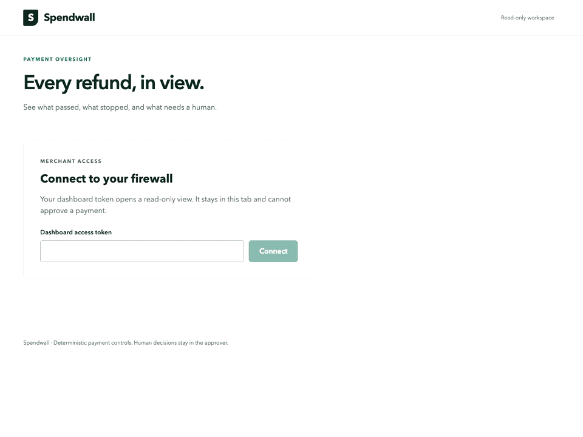
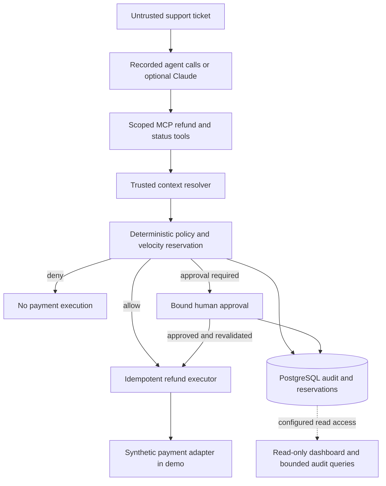

# Spendwall

A deterministic payment policy firewall that checks an AI support agent's refund requests before execution.

An injected ticket or an agent loop should not become permission to move money.
Spendwall combines trusted payment context, policy evaluation, spending reservations, bound human approval and an audit trail.
**There is no LLM in the policy decision path.**

The local demo runs real firewall modules with recorded agent calls and synthetic payment responses.
Separate sandbox adapters have recorded live evidence; they are not an end-to-end production payment service.
Start with the [judge guide](docs/judge-guide.md) and [threat model](docs/threat-model.md).

## Quickstart

Install Node.js **24.21.0**, pnpm **11.24.0**, Git and Docker with its daemon running.
These versions are pinned in `.node-version` and `package.json`.
No PayPal or Claude credentials are needed for this path.

```sh
git clone https://github.com/AndrewDongminYoo/spendwall.git
cd spendwall
pnpm install --frozen-lockfile
pnpm demo
```

Expect four `PASS` lines: `small` with one synthetic payment, `approval` with one, `injection` with zero, and `velocity` with two.
Approval is explicitly scripted in this mode; it does not represent mobile or biometric approval.
The runner starts and removes its own disposable PostgreSQL container.
It does not use the Compose database or captures created by `pnpm seed`.
The [judge guide](docs/judge-guide.md) explains prerequisites, timing evidence, cleanup and separate sandbox verification.

## See the audit dashboard

```sh
pnpm --filter @spendwall/dashboard build
pnpm dashboard:preview
```

Open the loopback URL printed by the preview and enter its disposable dashboard token.
Use the three prompt buttons to inspect large refund attempts, denial groups and support-bot reservations.
To unlock the policy workshop, enter the separate disposable reviewer token printed by the preview.
Reviewer access permits exact replay counts that can reveal retained payment attributes; grant it only to trusted policy reviewers ([authorization details](docs/dashboard.md#policy-workshop-optional)).
The policy workshop also supplies a synthetic draft, a YAML diff and seven-day replay counts from encrypted fixture inputs.
Confirming a draft downloads YAML; it does not change the running policy.
Stop with Ctrl+C to remove that preview's database.
The preview has its own synthetic fixtures; it does not display the preceding `pnpm demo` run.
Its reconciliation panel shows matched, waiting, unmediated and mismatched refund observations from synthetic fixtures.



Earlier local audit-assistant recording; synthetic classification, synthetic payment outcomes, real HTTP/SQL and Studio widgets.
Run the current preview to inspect the added reconciliation panel.
[Static frame](docs/assets/dashboard-demo.png) · [Dashboard setup and query limits](docs/dashboard.md).
Local evaluation retains AG Studio's evaluation warnings and watermarks.
Trial issuance remains deferred; there is no hosted demo URL yet.

The [hosting preparation guide](docs/hosting.md) provides a container and Render template for an authenticated, read-only API.
The hosted entrypoint does not serve AG Studio assets; public UI deployment and the 48-hour operational check remain pending.
The separate [local webhook receiver](docs/webhooks.md) verifies observed sandbox refunds and compares them with recorded firewall completions.
Real webhook delivery and direct-dashboard refund acceptance remain pending; an unmatched observation does not prove complete bypass detection.

The [invoice policy baseline](docs/invoice-policy.md) checks amount caps and recipient domains, with atomic per-customer daily send reservations.
Run `node scripts/invoice-demo.mjs` for a synthetic console example; it does not create or send provider invoices.

## Architecture and trust boundaries

The solid path is the synthetic demo composition in `apps/agent-demo`.
The dashboard reads its separately configured database; dotted connections require application configuration.



`pnpm proxy` is the separate W0 sandbox integration, with recorded MCP/SSE and REST refund evidence.
It does **not** wire in this policy/approval composition and must not be exposed as a protected public gateway.
See [proxy boundaries](docs/proxy.md), [approvals](docs/approvals.md) and [approval API](docs/approval-api.md).
The [Flutter approver](apps/approver/README.md) implements the local approval flow for iOS and Android.
Real push, physical-device biometrics and integrated sandbox acceptance remain pending in [#15](https://github.com/AndrewDongminYoo/spendwall/issues/15).

## Where AI is used

| Surface            | Implemented behavior                                                                      | Default and limit                                                                                                                    |
| ------------------ | ----------------------------------------------------------------------------------------- | ------------------------------------------------------------------------------------------------------------------------------------ |
| Support agent      | Optional Claude Agent SDK asks scoped firewall tools to act                               | Default demo replays recorded calls; `--live` opts into a paid model while payments remain synthetic                                 |
| Approval summary   | Optional Claude generates advisory text from bounded, redacted context                    | Disabled without configuration; never authorizes a payment                                                                           |
| Audit queries      | Optional Claude selects one of three intents; server computes data and widget shape       | Preview uses a labelled synthetic classifier; no model-generated SQL or payment tools                                                |
| Policy compilation | Optional Claude proposes validated YAML for diff review and exact historical reevaluation | Disabled without configuration; encrypted replay is opt-in, missing inputs stay unavailable, and confirmation only downloads a draft |

Codex and Claude Code assisted development, documentation and review; checked-in policies and deterministic code enforce decisions.
Model output, ticket text and generated summaries remain untrusted.
See the [agent guide](apps/agent-demo/README.md), [summary boundary](docs/approval-api.md#optional-advisory-summaries) and [audit assistant contract](docs/dashboard.md#audit-assistant) for configuration and data disclosure.
The [policy workshop contract](docs/dashboard.md#policy-workshop-optional) explains encrypted retention, partial coverage and confirmed draft export.

## Development and verification

For contribution, install the [Trunk CLI](https://docs.trunk.io/code-quality/get-started/install), then run:

```sh
trunk install
pnpm hooks:install
pnpm check
pnpm --filter @spendwall/dashboard build
trunk check --all --no-fix
docker compose --env-file .env.example config --quiet
```

Formatting and type checks do not prove payment behavior.
Tests exercise local HTTP/MCP, persisted PostgreSQL state, denial, concurrency, expiry and retry boundaries with synthetic providers.
Live connectivity and mobile delivery require separate verification.
Trunk manages staged secret scanning and pre-push checks; CI repeats the declared gates.
Keep credentials and private runtime state out of Git.

| Path                  | Purpose                                                                               |
| --------------------- | ------------------------------------------------------------------------------------- |
| `packages/policy`     | Policy loading, CEL evaluation and integer-money normalization                        |
| `apps/firewall`       | Sandbox proxy, trusted context, audit/velocity, approval and dashboard server modules |
| `apps/agent-demo`     | Executable synthetic composition with optional Claude agent                           |
| `apps/dashboard`      | React and AG Studio read-only dashboard                                               |
| `apps/approver`       | Independent iOS/Android approval app, excluded from pnpm                              |
| `migrations`, `tests` | PostgreSQL contracts and behavior verification                                        |
| `docs`                | Operating guides, threat model, specs and plans                                       |

## Project origin and license

Spendwall was newly started for the PayPal AI Hackathon during its submission period.
The repository's [first commit](https://github.com/AndrewDongminYoo/spendwall/commit/abbc46c) is dated October 13, 2026; the [official rules](https://paypalaihackathon.devpost.com/rules) list October 1–November 12, 2026 as the submission period.
Third-party packages retain their own licenses; the AG Studio evaluation is not a deployment license.

[MIT](LICENSE) · [Roadmap](https://github.com/AndrewDongminYoo/spendwall/issues/29).
